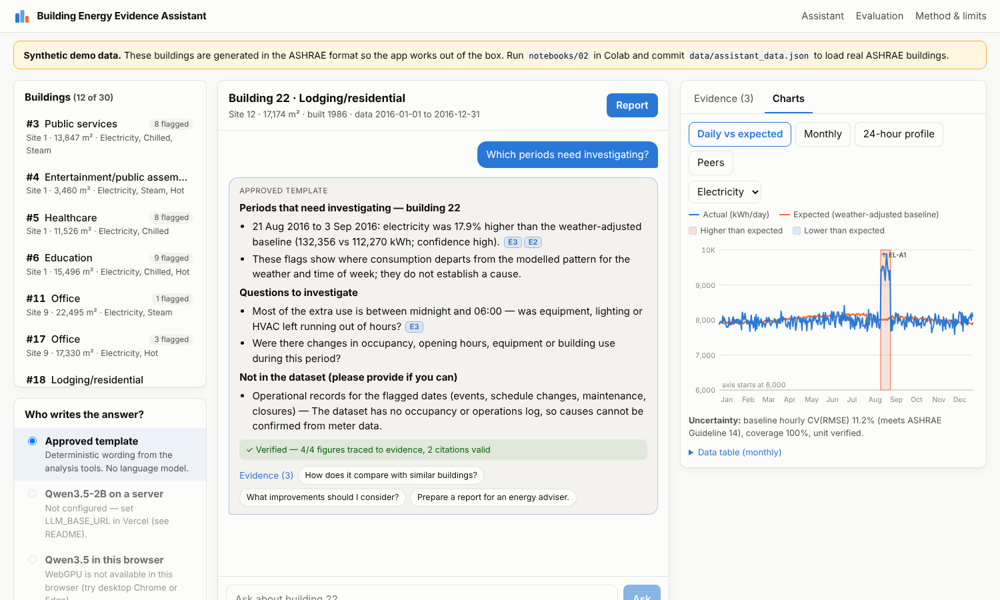
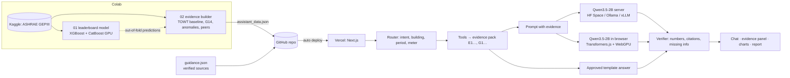

# Building Energy Evidence Assistant

A GenAI assistant for building energy advice, built on the **ASHRAE Great Energy Predictor III** dataset. People ask questions in plain English. Python tools do the calculations, and **Qwen3.5-2B** (Apache-2.0, 2 B parameters) explains the results. Every answer cites numbered evidence, shows its uncertainty and asks for information the data does not contain.

| You ask… | The system… | The language model… |
|---|---|---|
| "Summarise this building's energy use." | Retrieves the building's profile and consumption statistics | Writes a clear summary, including patterns and gaps |
| "Which periods need investigating?" | Compares readings with a weather-adjusted baseline and flags unusual periods | Explains them and suggests questions, **without claiming a cause** |
| "How does it compare with similar buildings?" | Picks a peer group and calculates percentiles | Explains the comparison and its limitations |
| "What improvements should I consider?" | Retrieves matching guidance from a small, verified collection | Discusses measures and **asks for missing building details** |
| "Would replacing the heating system save money?" | Detects that a savings estimate is being requested | Says what it **cannot** estimate yet and lists the information it needs |
| "Prepare a report for an energy adviser." | Combines profile, analysis, evidence and open questions | Writes the executive summary of a downloadable report |



## What makes it trustworthy

These features address the Rivne use-case requirements: visible uncertainty, traceable explanations, and approved calculation logic for numerical estimates.

* **Approved calculation logic.** All figures come from `notebooks/ashrae_evidence.py`, which notebook 02 runs. The LLM never does arithmetic.
* **Traceable explanations.** Each tool returns numbered evidence items (`E1`… for records and calculations, `G1`… for guidance) with their source and method. Answers cite them, and clicking a citation opens the record.
* **Visible uncertainty.** Every baseline reports its ASHRAE Guideline 14 CV(RMSE) and NMBE. Flagged periods carry an expected range and a confidence level, and peer comparisons list their limitations. Unit status (verified / converted / unverified) is shown too.
* **Verification on every answer.** Each number in the answer must match the evidence pack and each citation must exist. When information is missing, the answer must say so. Answers that fail are flagged, and the approved template answer is one click away.
* **Measured.** The `/evaluation` page re-runs a test suite generated from the data. It checks the building, analysis, period and meter, whether the calculated figure is reproduced, numeric faithfulness, citation validity and coverage, and whether missing information is acknowledged.

## Architecture



## Can Vercel run Qwen3.5-2B?

**Not on Vercel's servers.** Vercel Functions have no GPU and a ~250 MB bundle cap, so a 2 B-parameter model cannot run inside them. This app gives you three options that all deploy on Vercel:

| Mode | Where the model runs | Cost | Set-up |
|---|---|---|---|
| **In-browser (default demo)** | The visitor's GPU via WebGPU (`onnx-community/Qwen3.5-2B-ONNX-OPT`, Transformers.js v4), or the CPU when no GPU is available (slow; 0.8B recommended) | Free | None. The visitor clicks *Load model*, and the first load downloads about 1.5–2 GB (2B) |
| **Server** | Any OpenAI-compatible endpoint: Hugging Face Space (`llm-server/`), Ollama, vLLM, or a Colab tunnel (`notebooks/03`) | Free (CPU Space) or paid GPU | Set `LLM_BASE_URL`, `LLM_API_KEY`, `LLM_MODEL` in Vercel |
| **Approved template** | No model, deterministic wording | Free | None. Always available as the fallback |

## Deploy (GitHub → Vercel)

1. **Push this folder to a new GitHub repository** (it is a standard Next.js 16 app at the repo root).
2. In Vercel choose **Add New → Project → Import** the repository. The framework preset (Next.js) is detected automatically; leave the defaults.
3. Optional: add environment variables (see `.env.example`) for server mode, then **Deploy**.
4. Every push to `main` redeploys. CI (`.github/workflows/ci.yml`) runs the type check, smoke test, evaluation and build.

The repo ships with **synthetic demo data** (clearly labelled in the UI), so the first deploy works without Kaggle. Replace it with real buildings like this:

## Load real ASHRAE buildings (Google Colab)

1. Accept the competition rules on Kaggle, then add `KAGGLE_USERNAME` and `KAGGLE_KEY` to Colab **Secrets**.
2. Open **`notebooks/02_build_assistant_evidence_colab.ipynb`** in Colab and run all cells (no GPU needed). It downloads the data with `kagglehub.competition_download('ashrae-energy-prediction')`, then builds and downloads `assistant_data.json`.
3. Commit the file as `data/assistant_data.json`, and Vercel redeploys. Set `BUILDING_IDS` in the notebook to choose specific buildings.
4. Optional: run notebook 01 first. Its out-of-fold predictions then appear as a second baseline ("leaderboard model") in the charts and evidence.

## The leaderboard notebook

**`notebooks/01_ashrae_leaderboard_colab.ipynb`** (GPU runtime):

* **Cleaning:** site 0 electricity before 21 May 2016, zero electricity readings, flat-lines of 48 h or more, and out-of-season zero streaks.
* **Weather:** UTC → local time per site, gap filling, humidity, and 24/72/168 h rolling and lag features.
* **Models:** GPU XGBoost and GPU CatBoost, one per meter, with month-block cross-validation plus a full-data refit, and Drive checkpoints so a disconnect can resume. LightGBM and a CPU-only fallback are options.
* **Validation:** checked against the public **leaked 2017–2018 readings** (sites 0, 1, 2, 4, 15; only buildings whose 2016 leak matches the official data). Ensemble weights and a per-meter scaling factor are tuned on them.
* **Two submissions** (*model only* and *model + leak insertion*), submitted with the Kaggle CLI.

**About the leaderboard:** the competition closed in 2019. Late submissions are still scored (public and private) but are not ranked. The winning private score was 1.231, with 1.232 and 1.234 for 2nd and 3rd. Report both of your private scores, because the top teams also inserted leaked labels.

## Evaluation

* **Assistant (live):** `/evaluation`, or `npm run eval`, generates around 88 questions from the evidence file, including paraphrases, follow-ups that rely on context, months and seasons, unknown buildings, out-of-range years and savings questions, and scores them on the checks above.
* **Language model:** `LLM_BASE_URL=… npm run eval -- --llm` asks the same questions through Qwen3.5-2B and writes `data/llm_eval_results.json`. Commit it and the evaluation page shows Qwen's scores next to the template baseline.
* **Prediction model:** notebook 01 writes `cv_report.csv`, `validation_report.csv` (leak RMSLE per model and meter) and `model_summary.json`.
* **Baseline model:** per building and meter, ASHRAE Guideline 14 CV(RMSE) and NMBE on out-of-sample, month-cross-fitted predictions.

## Local development

```bash
npm install
npm run dev            # http://localhost:3000
npm test               # smoke test: routing + tools + verification
npm run eval           # deterministic evaluation suite
LLM_BASE_URL=http://localhost:11434/v1 LLM_MODEL=hf.co/unsloth/Qwen3.5-2B-GGUF:Q4_K_M npm run dev   # with Ollama
```

## Project structure

```
app/                 Next.js App Router: pages (JSX) and API routes (TypeScript)
  api/chat           route → tools → evidence → (LLM stream) → verification, as NDJSON
  api/report         structured consultation report (markdown/HTML/PDF via print)
  api/eval           live evaluation suite
components/          chat, evidence panel, SVG charts, report modal, model picker
lib/                 router, tools, evidence pack, templates, verifier, LLM client, eval (TypeScript)
public/qwen-worker.js  in-browser Qwen3.5 (Transformers.js + WebGPU)
data/                assistant_data.json (from notebook 02), guidance.json (verified cards)
notebooks/           01 leaderboard · 02 evidence builder · 03 Colab Qwen endpoint · ashrae_evidence.py
llm-server/          Hugging Face Space (llama.cpp) serving Qwen3.5-2B with an API key
eval/                CLI evaluation (template or LLM)
```

## Limitations

* The meter data shows when and how much energy was used, not why. Flagged periods are prompts for investigation.
* Savings and payback need system specifications, costs, tariffs and financing rules. None of these are in ASHRAE, so the assistant asks for them.
* Units differ by site. They are converted to kWh where the Building Data Genome 2 unit table gives a factor, steam stays in lbs, and other units are marked unverified.
* Peer comparisons are normalised by floor area only. Cross-site groups mix climates.
* The guidance cards paraphrase public sources (ENERGY STAR Building Upgrade Manual, PNNL Building Re-tuning, LBNL, ASHRAE Guideline 14 via NREL). A qualified energy adviser should review them before production use.
* Browser mode works best with WebGPU (desktop Chrome or Edge) and a capable GPU; the 2B model can exhaust laptop GPU memory, so use 0.8B there. If the GPU is reset twice on a site, Chrome blocks WebGPU for that site until it restarts; the app detects this and offers CPU mode. Server mode on a free CPU Space is slow: lower `LLM_MAX_TOKENS` if responses hit Vercel's 60 s limit.

## Credits

ASHRAE GEPIII data (Kaggle) · Building Data Genome 2 (units) · LBNL TOWT baseline (Mathieu et al., 2011) · Qwen3.5-2B (Qwen team, Apache-2.0) · Transformers.js (Hugging Face) · llama.cpp.
